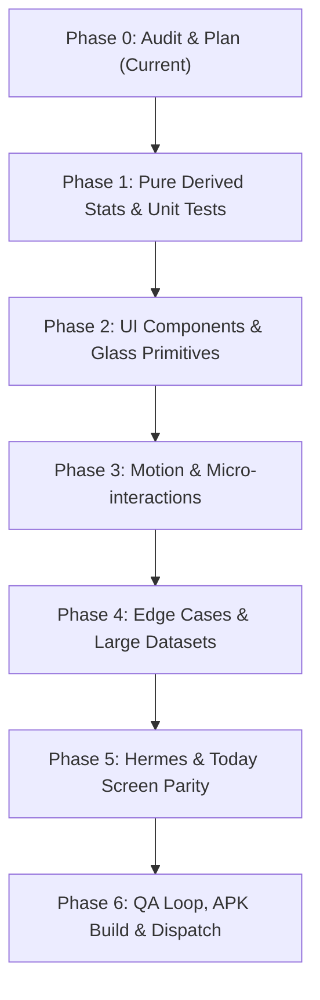

# GreenDream Body Tab (Gym & Training) Rebuild Plan (BODY_PLAN.md)

## 1. Executive Summary & Design Vision

Rebuild the **Body** tab (`GymScreen`) of GreenDream to match the glass-cyan dark interface specified in the mockups. The rebuild focuses exclusively on the visual layer and read-only derived stats, leaving the underlying data models (`workoutSessions`, `workoutPlans`, `trainingPrograms`, `exercises`, `bodyweightEntries`, `settings`) completely intact and backward-compatible.

### Key Goals:
- **Visual Precision**: Glass-cyan cards (`.glass-card`), glowing accent tokens (`--accent`, `--accent-light`, `--accent-rgb`), responsive 2x2 metric tiles, 18-week activity heatmap, interactive week strip, "Today's workout" hero card, and set-by-set exercise comparison table.
- **Pure Derived Statistics**: Instant memoized computation of volume, session duration, records (Epley 1RM progression), period-over-period deltas, multi-week streaks, and 5-level activity heatmaps across Week, Month, Year, and All ranges.
- **Flawless RTL & Accessibility**: Full logical layout (`ms/me/ps/pe`, `start/end`), right-to-left mirroring of heatmap timelines and week strips, $\ge 44\text{px}$ touch targets, minimum 12px text, safe-area awareness, and clearance for the bottom navigation and floating `+` FAB.
- **Trilingual Localization**: Complete ICU plural rules for English, French, and Arabic.
- **Zero Data Model Mutation**: 100% read-only derived stats; all existing sessions, weights, programs, and plans load unchanged.

---

## 2. Phase 0 Audit & Existing Codebase Inventory

### 2.1 Current Files & Components
| File Path | Role | Reusability Plan |
|:---|:---|:---|
| [`src/screens/GymScreen.tsx`](file:///c:/Users/yacine/OneDrive/Desktop/habit%20tracer/src/screens/GymScreen.tsx) | Main Body / Gym tab container (961 lines) | Rebuild top section with mockup layout (Week strip, Today card, Progress tiles, Heatmap, Last session comparison); keep existing sections (Anatomical body recovery, Weight progress chart, Program templates, History log) below in cohesive glass styling. |
| [`src/services/gymProgramService.ts`](file:///c:/Users/yacine/OneDrive/Desktop/habit%20tracer/src/services/gymProgramService.ts) | Training program manager | Fully reuse `getActiveProgram()`, `getNextWorkout()`, `getAllPrograms()`, `setActiveProgram()`, `duplicateProgram()`. |
| [`src/components/WorkoutSessionModal.tsx`](file:///c:/Users/yacine/OneDrive/Desktop/habit%20tracer/src/components/WorkoutSessionModal.tsx) | Session logger modal | Reuse directly for "Start workout", "Resume workout", and "Log New". |
| [`src/components/LogWeightModal.tsx`](file:///c:/Users/yacine/OneDrive/Desktop/habit%20tracer/src/components/LogWeightModal.tsx) | Scale weigh-in logger | Reuse directly for scale logging. |
| [`src/components/charts/AreaCurve.tsx`](file:///c:/Users/yacine/OneDrive/Desktop/habit%20tracer/src/components/charts/AreaCurve.tsx) | Interactive smooth SVG area chart with scrubber | Reuse for bodyweight progress chart with accent glow and gradient fill. |
| [`src/components/AnatomicalBody.tsx`](file:///c:/Users/yacine/OneDrive/Desktop/habit%20tracer/src/components/AnatomicalBody.tsx) | Interactive SVG muscle model | Keep in the secondary/extended section below the main cards. |

### 2.2 Data Shapes & Schema Verification
- **`WorkoutSession`**:
  ```ts
  interface WorkoutSession extends BaseEntity {
    plan_id: UUID | null;
    name: string;
    local_date: string; // 'YYYY-MM-DD'
    started_at: number; // epoch ms
    ended_at: number | null; // epoch ms (null = in progress)
    notes: string;
    sets: SetEntry[];
  }
  ```
- **`SetEntry`**:
  ```ts
  interface SetEntry extends BaseEntity {
    session_id: UUID;
    exercise_id: UUID;
    weight_kg: number;
    reps: number;
    is_warmup: boolean;
  }
  ```
- **`TrainingProgram`**:
  ```ts
  interface TrainingProgram extends BaseEntity {
    name: string;
    template_type: ProgramTemplateType;
    days_per_week: number;
    scheduled_weekdays: number[]; // [1=Mon, 2=Tue, 3=Wed, 4=Thu, 5=Fri, 6=Sat, 0=Sun]
    days: TrainingDay[];
    is_active: boolean;
    is_paused: boolean;
  }
  ```
- **`BodyweightEntry`**:
  ```ts
  interface BodyweightEntry extends BaseEntity {
    local_date: string; // 'YYYY-MM-DD'
    weight_kg: number;
  }
  ```
- **`AppSettings`**:
  - `weight_unit`: `'kg' | 'lb'`
  - `week_start_day`: `0 | 1` (0 = Sunday, 1 = Monday)
  - `modules.gym`: boolean toggle

---

## 3. Selector Architecture & Derived Math Specifications

All derived statistics will reside in a single dedicated pure-function service: [`src/services/gymDerivedStats.ts`](file:///c:/Users/yacine/OneDrive/Desktop/habit%20tracer/src/services/gymDerivedStats.ts).

### 3.1 Date & Range Boundaries
- All calendar math operates on local calendar dates (`YYYY-MM-DD`) using year, month, and day components, avoiding 24-hour millisecond drift across Daylight Saving Time (DST).
- **Ranges**:
  - `week`: Monday to Sunday (or Sunday to Saturday if `week_start_day === 0`) containing `anchorDate`.
  - `month`: 1st day to last day of current calendar month.
  - `year`: Jan 1 to Dec 31 of current calendar year.
  - `all`: Epoch start to infinity.
- **Previous Ranges**:
  - `week` &rarr; preceding 7-day calendar week.
  - `month` &rarr; full preceding calendar month (e.g. Oct 1–31 for Nov).
  - `year` &rarr; full preceding calendar year.
  - `all` &rarr; `null` (no delta comparison).

### 3.2 Volume Calculation
$$\text{Session Volume} = \sum_{\text{sets}} (\text{weight} \times \text{reps})$$
- If `weight === 0` (bodyweight set), look up user's bodyweight on or immediately prior to session date from `bodyweightEntries`; if none exists, weight is 0.
- Unit conversion: Store remains `kg`. When `settings.weight_unit === 'lb'`, convert display volume:
  $$\text{lb} = \text{kg} \times 2.20462262$$
  Formatted with localized thousands separators (e.g. `124,500 kg` or `274,475 lb`).

### 3.3 Duration Formatting
- Total minutes: $\sum \frac{\text{ended\_at} - \text{started\_at}}{60000}$ for completed sessions.
- Format:
  - $\ge 60$ minutes: `"{h}h {m}m"` (e.g., `5h 42m`)
  - $< 60$ minutes: `"{m} min"` (e.g., `42 min`)

### 3.4 Estimated 1RM (Epley Formula) & Personal Records (PRs)
$$\text{e1RM} = \text{weight} \times \left(1 + \frac{\min(\text{reps}, 12)}{30}\right)$$
- Warmup sets (`is_warmup: true`) are excluded.
- **Record Rule**: A record is an event where an exercise's best e1RM in a session strictly exceeds all of that exercise's prior completed sessions.
  - The first session ever for an exercise is a baseline, **not** a record.
  - Ties are **not** records.
  - At most one record per exercise per session.
  - Records in range = count of record events where session date falls within the selected range.

### 3.5 Delta Chips
- If $\text{previous} = 0$ and $\text{current} > 0$ &rarr; Chip: `"New"`.
- If $\text{previous} = 0$ and $\text{current} = 0$ &rarr; No chip rendered.
- If range is `'all'` &rarr; No chip rendered.
- **Volume & Time**: Percentage change rounded to integer:
  $$\Delta\% = \operatorname{round}\left(\frac{\text{current} - \text{previous}}{\text{previous}} \times 100\right)$$
  e.g., `"+12%"`, `"-5%"`.
- **Workouts & Records**: Absolute difference:
  $$\Delta = \text{current} - \text{previous}$$
  e.g., `"+3"`, `"-1"`.
- **Color semantics**: Positive uses accent glow chip with $\nearrow$ arrow. Negative uses neutral white-tinted chip with $\searrow$ arrow (**NO red**, guilt-free).

### 3.6 Weekly Streak Calculation
- `weeklyGoal`: Training days in active program (`activeProgram.days_per_week`), fallback 3.
- Counts consecutive completed weeks (looking backwards from last completed week) where completed sessions $\ge \text{weeklyGoal}$.
- The **current incomplete week**:
  - If current week sessions $\ge \text{weeklyGoal}$, streak increments immediately.
  - If not yet met, current week does **not** break the streak.
- If streak is 0, the streak badge is hidden.

### 3.7 Week Strip (7 Days)
For each day in the current week:
- `isDone`: At least 1 completed session on that calendar date.
- `isToday`: Matches device local date.
- `isPlanned`: Active program has a scheduled workout on this weekday and it is not yet completed.
- `isFuture`: Calendar date is after today.

### 3.8 Today's Workout Card State Machine
1. **Scheduled Today**: Active program has a workout scheduled for today's weekday.
   - Shows program name, muscle focus subtitle, exercise count, estimated duration, and primary **"Start workout"** button.
2. **Done Today**: Session completed today.
   - Shows session name, summary (sets, volume), and secondary button **"Start another workout"**.
3. **In Progress**: Session started today with `ended_at === null`.
   - Shows elapsed time and **"Resume workout"** button.
4. **Rest Day**: Program is active, but today is not a scheduled weekday.
   - Shows "Rest day", next scheduled workout and weekday, and secondary button **"Start a workout anyway"**.
5. **No Program**: No active program.
   - Friendly glass prompt: **"Create a plan"** primary button and **"Start empty workout"** secondary button.

### 3.9 Activity Heatmap (18 Weeks $\times$ 7 Weekdays)
- Covers the last 18 calendar weeks ending with the current week ($18 \times 7 = 126$ cells).
- Day volume $V_d = \sum \text{volume of sessions on date } d$.
- Maximum day volume $V_{\max} = \max_{d} (V_d)$ in the 18-week window.
- **Levels**:
  - Level 0: $V_d = 0$ (No workout) &rarr; `rgba(255, 255, 255, 0.07)`
  - Level 1: $0 < V_d \le 0.25 \times V_{\max}$ (or workout with 0 volume) &rarr; `rgb(var(--accent-rgb) / 0.28)`
  - Level 2: $0.25 < V_d \le 0.50 \times V_{\max}$ &rarr; `rgb(var(--accent-rgb) / 0.50)`
  - Level 3: $0.50 < V_d \le 0.75 \times V_{\max}$ &rarr; `rgb(var(--accent-rgb) / 0.75)`
  - Level 4: $V_d > 0.75 \times V_{\max}$ &rarr; solid `var(--accent)` with glow `0 0 8px rgb(var(--accent-rgb) / 0.80)`.
- RTL: Time axis mirrors (most recent week at the start side).
- Interactive tooltip: Tapping a cell shows date, workout name, and volume in a compact glass chip.

### 3.10 Exercise Comparison ("Last Session" Card)
- Default Exercise:
  1. First exercise of today's plan that has history.
  2. Otherwise, the most recently performed exercise across all history.
  3. If no sessions exist, card is hidden.
- Compares the most recent completed session containing the exercise with the one immediately prior.
- Index-by-index set comparison table: `Set | Previous | Now`.
- "Increased" chip appears if best e1RM now $>$ best e1RM previous.
- Footer trend line: `"Estimated one-rep max is up {n}%"`.
- Tap exercise name &rarr; opens quick glass sheet to switch to any other exercise.

---

## 4. Phase-by-Phase Execution Roadmap



### Phase 1: Pure Derived Stats & Unit Tests
- Create [`src/services/gymDerivedStats.ts`](file:///c:/Users/yacine/OneDrive/Desktop/habit%20tracer/src/services/gymDerivedStats.ts).
- Create [`tests/gymDerivedStats.test.mjs`](file:///c:/Users/yacine/OneDrive/Desktop/habit%20tracer/tests/gymDerivedStats.test.mjs).
- Test suite: empty data, single session, week/month/year boundaries, week starts (0 vs 1), DST, Epley record rules, delta chips, streaks across year boundaries, heatmap levels, unit conversions.
- *Deliverable*: 100% passing tests, verified via `npm test`. Stop and await user "go".

### Phase 2: Page Structure & Components
- Implement:
  1. `WeekStripCard.tsx`: 7 date circles, accent done states with checkmark, today ring, planned indicator.
  2. `TodayWorkoutCard.tsx`: 5 states, 60px glass icon tile, primary gradient button with glow.
  3. `ProgressSection.tsx`: Segmented control (Week, Month, Year, All), 2x2 GlassTile metric grid, rolling count-up numbers.
  4. `ActivityHeatmapCard.tsx`: 18x7 grid, staggered column entry, interactive tooltip, RTL mirror.
  5. `LastSessionCard.tsx`: Header with "Increased" chip, exercise switcher bottom sheet, Set | Previous | Now table, e1RM trend footer.
  6. Reconstructed `GymScreen.tsx`: Top section matches mockup; existing secondary sections (Anatomical body, Weight progress with `AreaCurve`, Program templates, Session history) preserved below in glass styling.
- *Deliverable*: Visual layout working, `npm run build` passing. Stop and await user "go".

### Phase 3: Motion & Kinetics
- Cards fade + translateY(8px &rarr; 0), 500ms, 60ms stagger.
- Week strip checks pop (scale 0.6 &rarr; 1, 500ms).
- Metric numbers count up over 900ms.
- Heatmap column stagger (25ms per column).
- Respects `prefers-reduced-motion`.
- Stop and await user "go".

### Phase 4: Edge Cases, Units & Large Datasets
- 0-session clean state: friendly empty messages ("Your first workout will light this up").
- 500+ session dataset benchmark: memoized selectors ensure sub-16ms re-renders on range switches.
- Weight unit toggling (`kg` &harr; `lb`): display numbers update immediately without mutating storage.
- Stop and await user "go".

### Phase 5: Hermes & Today Screen Alignment
- Update Today screen's Body tile and Hermes read tools (`get_workouts`, `get_weight_trend`) to use `gymDerivedStats.ts`.
- Stop and await user "go".

### Phase 6: Autonomous QA Loop, APK Build & Delivery
- Responsive verification across 360px & 430px viewports.
- RTL verification in Arabic.
- Color verification across all 4 accent presets (Cyan, Lime, Violet, Rose) in Dark and Light modes.
- Production build: `npm run build`.
- Capacitor sync: `npx cap sync android`.
- Android APK compilation: `gradlew.bat assembleDebug`.
- Copy APK to `c:\Users\yacine\OneDrive\Desktop\GreenDream.apk` and dispatch to Telegram bot (`8647223409`).
- Update `docs/TEST_REPORT.md` and `docs/BUGS.md`.

---

> [!IMPORTANT]
> **Phase 0 and Phase 1 are complete.**
> - Phase 0 (Audit & Plan): Complete.
> - Phase 1 (Pure Derived Stats Service & Unit Tests): Complete with 14/14 unit tests passing (67/67 overall).
> Awaiting your explicit **"go"** to begin Phase 2 (Page Structure & Glass Components).
