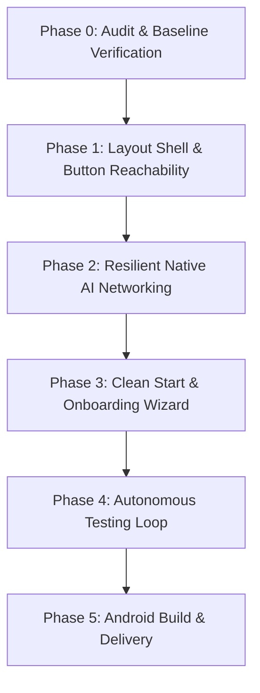

# GreenDream System Stabilization & Modular Setup Plan (FIX_PLAN.md)

## 📌 Executive Summary
This document outlines the systematic, zero-regression remediation plan for GreenDream (React + Tailwind + Capacitor Android). It addresses three core problems:
1. **Unreachable & Hidden Buttons**: Layout shell bottom clearance, FAB overlap, touch hover states, z-index hierarchy, and soft keyboard avoidance.
2. **AI Request Failures**: Direct native networking via `CapacitorHttp`, eliminating `localhost:3001` pitfalls, resilient multi-model failover, and transparent error handling.
3. **Clean Slate & Setup Flow**: Pure empty state on first launch, a modular onboarding wizard (Name, Language, Modules, Quick Setup, Look & Feel), and reactive module deactivation across navigation, Today widgets, quick-add, and score engines.

---

## 🛡️ Non-Negotiable Architectural Rules
* **Backwards Compatibility**: Existing `localStorage` keys and data load untouched. Users with existing data are automatically marked `settings.onboarded = true` with all modules enabled.
* **Optional Schema Extensions**:
  * `settings.onboarded?: boolean` (default `false` for fresh, `true` for existing)
  * `settings.modules?: Record<ModuleId, boolean>` (`prayer`, `finance`, `gym`, `calendar`, `journal`, `maintenance`, `weekly_review`, `assistant`)
  * `settings.ai?: AIAssistantSettings`
* **Zero Hardcoded Styles**: All visuals leverage established CSS variable tokens (`--accent`, `--bg`, `--color-surface`, etc.) in Dark Glass, Light Glass, and Performance Matte modes.
* **Tri-Lingual & RTL Parity**: Every new UI element and message is registered in EN, FR, and AR with full logical padding/margins (`ps-*`, `pe-*`, `ms-*`, `me-*`, `start-*`, `end-*`).

---

## 🗺️ Phased Implementation Breakdown



### Phase 0: Audit & Registry (Completed)
* **Deliverable**: `/docs/BUGS.md` generated with verified root causes and severity tags (P0/P1/P2).
* **Scope**: No code modifications in this phase.

---

### Phase 1: Layout Shell, Z-Index Token Hierarchy & Touch Accessibility
#### 1. Unified Layout Shell
* Files: `src/App.tsx`, `src/index.css`, `src/components/Navigation.tsx`.
* Problem: Floating bottom nav (62px + 10px safe inset) and floating "+" FAB (50px at `bottom: calc(74px + inset)`, `end-5`) cover bottom rows of content.
* Solution:
  * Introduce standardized CSS variables in `src/index.css`:
    * `--nav-clearance: calc(max(10px, env(safe-area-inset-bottom)) + 72px);`
    * `--fab-clearance: calc(var(--nav-clearance) + 64px);`
  * Apply `padding-bottom: var(--fab-clearance)` and `scroll-padding-bottom: var(--fab-clearance)` to the primary `<main>` viewport in `src/App.tsx`.
  * Remove ad-hoc, redundant `pb-28` across individual screen root divs to eliminate double-padding discrepancies.

#### 2. Standardized Z-Index Scale
* Scale to enforce across components:
  * Content: `z-0` to `z-10`
  * Sticky Headers / Date Strips: `z-20`
  * Bottom Floating Nav Bar: `z-30`
  * Floating Action Button (FAB): `z-35`
  * Modal Backdrops / Sheet Scrims: `z-40`
  * Sheets / Bottom Drawers: `z-50`
  * Dialogs / Modals: `z-60`
  * Toasts / System Alerts: `z-70`

#### 3. Touch-First Action Visibility
* Replace all `opacity-0 group-hover:opacity-100` patterns (e.g. `AssistantScreen.tsx` copy button) with always-visible 44px tap targets or touch-friendly icon triggers.
* Ensure row edit/delete actions remain accessible on mobile without mouse hover states.

#### 4. Android Keyboard Avoidance
* Set `android:windowSoftInputMode="adjustResize"` in `android/app/src/main/AndroidManifest.xml`.
* Configure Capacitor Keyboard in `capacitor.config.json`:
  ```json
  "plugins": {
    "Keyboard": {
      "resize": "body",
      "style": "dark"
    }
  }
  ```
* Pin `AssistantScreen` chat input using sticky/fixed bottom positioning above the keyboard (`bottom: 0`), preventing it from getting submerged when typing.

---

### Phase 2: Resilient Native AI Networking
#### 1. Capacitor Native HTTP Configuration
* Update `capacitor.config.json` to enable `CapacitorHttp`:
  ```json
  "plugins": {
    "CapacitorHttp": {
      "enabled": true
    }
  }
  ```
  *Bypasses WebView CORS restrictions when communicating directly with AI APIs or custom endpoints.*

#### 2. Remove Deprecated Localhost Default
* In `src/services/storage.ts` and `src/types/index.ts`:
  * Default `backend_url` is removed or left blank (`""`).
  * Direct mode (`direct_mode: true`) is the default and preferred execution path.
  * Custom backend URLs must use HTTPS (cleartext HTTP requires explicit user opt-in in advanced settings).

#### 3. Chat UX & State Recovery
* Seamless multi-model failover: `gemini-3.6-flash` -> `gemini-3.5-flash` -> `gemini-3.1-flash-lite`.
* Clean payload sanitizer: remove empty parts and eliminate prompt duplication.
* Transparent error cards:
  * No Key: Clean setup prompt card with "Configure in Settings".
  * 401/403: "Invalid API Key" with direct link to update.
  * 429: "Free-tier quota limit reached. Please wait a moment."
  * Network/Offline: "Offline. Local records remain safe."
  * Retry button visible on all transient errors.
  * 30-second strict request timeout with explicit cancellation.

---

### Phase 3: Clean Start & Modular Onboarding Flow
#### 1. Pure Empty State Engine
* Create `getCleanInitialState()` in `src/services/storage.ts`:
  * Empty habits, empty transactions, empty gym workouts, empty calendar events, empty journal notes.
  * Retains base system essentials: categories catalog, standard exercise definitions (`INITIAL_EXERCISES`), default layout structure.
* Move demo records into a dedicated `SAMPLE_DEMO_DATA` export:
  * In Settings > Data: add "Load sample data" (with confirmation dialog) and "Remove sample data".

#### 2. Step-by-Step First Launch Setup Wizard (`OnboardingModal.tsx`)
Rendered when `!state.settings.onboarded`:
* **Step 1: Welcome & Profile**: User name input, live Language selector (EN / FR / AR with instant RTL swap).
* **Step 2: Module Selection**:
  * Presets: "Everything", "Essentials" (Prayer, Money, Tasks), "Minimal" (Tasks only).
  * Granular checkboxes with icons and descriptions:
    * 🕌 Daily Prayers
    * 💰 Money & Budgeting
    * 🏋️ Body & Gym
    * 📅 Calendar & Tasks
    * ✍️ Daily Journal
    * 🔧 Maintenance & Shopping
    * 📊 Weekly Review
    * 🤖 AI Assistant
* **Step 3: Quick Setup (Enabled modules only)**:
  * Money: Currency code (`DA`, `$`, `€`, `SAR`, etc.) + Monthly Budget.
  * Body: Weight unit (`kg` / `lb`) + starting weight.
  * AI: Quick API key input (optional, can be skipped).
* **Step 4: Look & Feel**:
  * Accent preset picker (Cyan, Lime, Violet, Rose).
  * Theme selector (Dark Glass, Light Glass, Performance Matte).
  * Interactive live preview card.
* **Step 5: Ready**:
  * Feature enablement summary + "Start GreenDream" button -> marks `onboarded = true` and navigates to clean Today dashboard.

#### 3. Complete Reactive Module Deactivation
When a module is disabled in `settings.modules`:
* **Navigation**: Tab removed from `BottomNavigation`. (Auto-adjusts: never fewer than 3 tabs; if only one main module is on, nav = Today \| Module \| More).
* **Today Screen**: Corresponding widget blocks unmount; no empty placeholders.
* **Quick-Add Sheet (+)**: Actions for disabled modules are hidden.
* **More Screen**: Disabled modules are removed from the hub list.
* **Discipline Scoring**: Daily score and Weekly score recalculate dynamically based only on enabled modules (e.g. if Prayer is off, maximum score scales accordingly).
* **Data Integrity**: Underlying records are preserved so re-enabling a module immediately restores all history.

---

### Phase 4: Autonomous Testing & Quality Loop
1. Automated production compilation (`npm run build`).
2. Scripted tests across mock viewports:
   * 360x640 (compact budget phone)
   * 360x800 (standard Android phone)
   * 412x915 (large screen)
   * 130% Font Scale simulation
   * LTR and RTL Arabic layout verification
3. Edge case testing:
   * Fresh install state (no data, setup flow triggers, smooth completion).
   * Upgrade state (pre-existing storage loads with `onboarded = true`).
   * AI network matrix (valid key, invalid key, offline mode, timeout recovery).
4. Iterative bug fixes logged in `/docs/BUGS.md` until zero P0/P1 defects remain.

---

### Phase 5: Android Verification & APK Build
* `npx cap sync android`.
* Verify `AndroidManifest.xml` permissions and input settings.
* Run Gradle build: `cd android && gradlew.bat assembleDebug`.
* Output APK verification and testing checklist for physical hardware.
