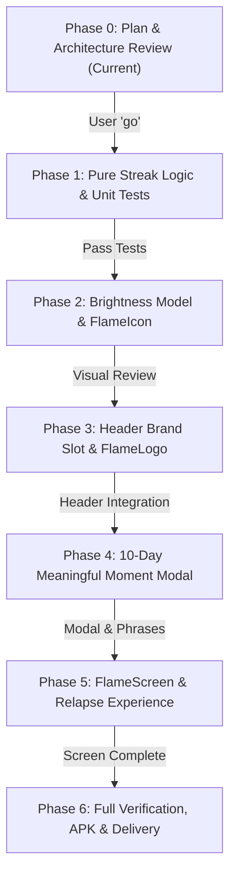

# GreenDream: Daily Sober Streak "Flame" Module Architecture & Implementation Plan (FLAME_V2_PLAN.md)

**Application**: GreenDream (React 18 + Tailwind CSS + Capacitor 8 Android, Local-First, Offline-Capable, EN/FR/AR with Full RTL)  
**Document Purpose**: Definitive technical specification, mathematical models, UI integration, test harnesses, and risk mitigation strategies for the sober streak Flame module.  
**Specification Reference**: GreenDream Sober Flame v2.0  
**Date**: November 7, 2026  
**Status**: **ALL PHASES (0-6) COMPLETE — VERIFIED, BUILT & DELIVERED TO TELEGRAM**

---

## 1. Executive Summary & Core Rules

### 1.1 The Philosophy of the Sober Flame
The Flame module tracks consecutive sober days in GreenDream with compassion, dignity, and visual beauty. It is grounded in three immutable tenets:
1. **Sober by Default**: Every calendar day is sober automatically. The user never needs to "check in" or confirm sobriety. If the app remains closed for days or weeks, every elapsed day increments the streak upon midnight rollover.
2. **The Only Action is "I Slipped"**: There is no "Did you stay clean today?" prompt, no guilt-inducing notification, and no red warning colors. If a slip occurs, the user taps a calm button. Today becomes Day 0, dropping the flame to an ember ($i=0.15$), while all past sober days remain permanently credited in lifetime stats.
3. **The Flame Replaces the Brand Mark**: In every screen header, the slot where the app logo/brand mark sits (start side in LTR, mirrored in RTL) shows the live glowing flame with the day count. The flame grows continuously brighter with time.

### 1.2 Module Enablement & Safe Defaults
- Flame is a toggleable core module (`modules.flame`).
- **When Flame is ON** (default `true`): The header brand slot displays the animated `<FlameLogo />` (28px flame + day count).
- **When Flame is OFF** (`modules.flame === false`): The header brand slot displays plain text `"GreenDream"` (font-semibold, no image, no flame icon). All streak and relapse data is retained in storage without data loss.

---

## 2. Complete Data Model (`settings.flame`)

### 2.1 Storage Schema in `AppSettings`
The entire state of the Flame module is consolidated within `state.settings.flame`. No per-day boolean flags or day-by-day logs are stored.

```typescript
// src/types/index.ts

export type FlameDayStatus = 'before_start' | 'sober' | 'relapse' | 'pending' | 'future';

export type FlameTriggerTag = 'stress' | 'tired' | 'social' | 'bored' | 'no_reason' | string;

export interface FlameRelapseEntry {
  date: string;          // 'YYYY-MM-DD' (local calendar day)
  at: number;             // Unix timestamp ms of when the slip was recorded
  trigger?: FlameTriggerTag; // Optional trigger tag selected by user
}

export interface FlameSavedPhrase {
  id: number;             // 1 to 12
  text: string;           // Localized phrase text
  dateEarned: string;     // 'YYYY-MM-DD'
  milestone: number;      // 10, 20, 30, etc.
}

export interface FlameCelebrationsState {
  streakKey: string;      // 'YYYY-MM-DD': date current streak began (day after last relapse, or startDate)
  done: number[];         // Milestones already celebrated for this streakKey: [10, 20, 30, ...]
  lastSeenDay: string;    // 'YYYY-MM-DD': last calendar day app was opened/evaluated
}

export interface FlameSettings {
  enabled: boolean;       // Master toggle for the flame module (default: true)
  startDate: string;      // 'YYYY-MM-DD': Day the journey began
  relapses: FlameRelapseEntry[]; // List of recorded slip events
  goalDays?: number;      // Optional streak target: e.g., 30, 90, 365 days
  showNumber: boolean;    // Whether to show the number beside flame in header (default: true)
  celebrations: FlameCelebrationsState;
  phraseHistory: number[];// IDs of the last 6 phrases shown (to prevent repetition)
  savedPhrases: FlameSavedPhrase[]; // User's bookmarked "Words you earned"
  shareWithHermes: boolean; // Default false: whether Hermes AI can see Flame data
  showTenDayWords: boolean; // Default true: full-screen milestone moment toggle
}
```

### 2.2 Default State
```typescript
export const DEFAULT_FLAME_SETTINGS: FlameSettings = {
  enabled: true,
  startDate: getTodayLocalDate(),
  relapses: [],
  goalDays: 30,
  showNumber: true,
  celebrations: {
    streakKey: getTodayLocalDate(),
    done: [],
    lastSeenDay: getTodayLocalDate(),
  },
  phraseHistory: [],
  savedPhrases: [],
  shareWithHermes: false,
  showTenDayWords: true,
};
```

---

## 3. Calendar Streak Mathematics & Edge-Case Proofs

### 3.1 Strict Local Calendar Day Arithmetic
> [!IMPORTANT]
> Never use 24-hour millisecond arithmetic (`86400000ms`). Timezone changes, Daylight Saving Time (DST 23h/25h days), leap seconds, and device clock adjustments cause millisecond drift. All date operations parse `YYYY-MM-DD` strings into year, month, and day components.

```typescript
// Pure local calendar day difference: (d2 - d1) in full integer days
export function calendarDaysBetween(fromDateStr: string, toDateStr: string): number {
  const [y1, m1, d1] = fromDateStr.split('-').map(Number);
  const [y2, m2, d2] = toDateStr.split('-').map(Number);
  // UTC Date constructor eliminates local DST shifts during subtraction
  const utc1 = Date.UTC(y1, m1 - 1, d1);
  const utc2 = Date.UTC(y2, m2 - 1, d2);
  return Math.round((utc2 - utc1) / (1000 * 60 * 60 * 24));
}

export function addCalendarDays(dateStr: string, days: number): string {
  const [y, m, d] = dateStr.split('-').map(Number);
  const dt = new Date(Date.UTC(y, m - 1, d + days));
  const year = dt.getUTCFullYear();
  const month = String(dt.getUTCMonth() + 1).padStart(2, '0');
  const day = String(dt.getUTCDate()).padStart(2, '0');
  return `${year}-${month}-${day}`;
}
```

### 3.2 Day Status Specification: `dayStatus(targetDate, today, flameSettings)`
For any calendar day string `targetDate`:
1. If `targetDate < flameSettings.startDate`: return `'before_start'`.
2. If `targetDate > today`: return `'future'`.
3. If `flameSettings.relapses.some(r => r.date === targetDate)`: return `'relapse'`.
4. If `targetDate === today`: return `'pending'` (today is in progress; never counted as completed until local midnight passes).
5. Otherwise: return `'sober'`.

### 3.3 Streak Computation: `calculateStreakStats(flameSettings, today)`
Let `today` be the current local date (`YYYY-MM-DD`).
1. **Find Latest Relapse**: Sort `relapses` descending by `date`.
   - If a relapse exists on `today`:
     - Today is `'relapse'`.
     - `currentStreak = 0` (instant drop to ember).
     - `streakKey = addCalendarDays(today, 1)` (tomorrow starts a new streak).
   - If the most recent relapse occurred on `relapseDate < today`:
     - Streak began on `dayAfterRelapse = addCalendarDays(relapseDate, 1)`.
     - `currentStreak = calendarDaysBetween(dayAfterRelapse, today)`.
     - Note: Because today is excluded, `dayAfterRelapse` through `yesterday` equals exactly `calendarDaysBetween(dayAfterRelapse, today)`.
     - `streakKey = dayAfterRelapse`.
   - If no relapses exist:
     - `currentStreak = Math.max(0, calendarDaysBetween(flameSettings.startDate, today))`.
     - `streakKey = flameSettings.startDate`.
2. **Total Flames Earned**:
   - Total sober days elapsed since `startDate` minus all unique relapse days.
   - `totalCompletedDays = Math.max(0, calendarDaysBetween(flameSettings.startDate, today))`.
   - `relapsesInRange = relapses.filter(r => r.date >= flameSettings.startDate && r.date < today)`.
   - `totalFlames = Math.max(0, totalCompletedDays - relapsesInRange.length)`.
3. **Longest Streak**:
   - Evaluated across all segments: from `startDate` to first relapse, between consecutive relapses, and from last relapse to `today`.
   - Computed deterministically in $O(R \log R)$ time where $R$ is relapse count.

### 3.4 Catch-Up on Open & Milestone Deduplication
When the app opens or resumes after being closed for multiple days:
1. `lastSeenDay = celebrations.lastSeenDay || today`.
2. `daysElapsed = calendarDaysBetween(lastSeenDay, today)`.
3. If `streakKey !== celebrations.streakKey`:
   - A reset occurred since celebrations were tracked.
   - Reset `celebrations.streakKey = streakKey`, `celebrations.done = []`.
4. Check all multiples of 10 up to `currentStreak`:
   - `allPassedMilestones = [10, 20, 30, ...].filter(m => m <= currentStreak)`.
   - `unseenMilestones = allPassedMilestones.filter(m => !celebrations.done.includes(m))`.
5. **Deduplication Rule**:
   - If `unseenMilestones.length > 0`:
     - The modal triggers for **exactly ONE milestone**: `highestMilestone = Math.max(...unseenMilestones)`.
     - **ALL** passed milestones are immediately appended to `celebrations.done` so they never trigger again.
6. `celebrations.lastSeenDay = today`.

### 3.5 Relapse Today vs. Past 7 Days & 24h Undo
- **Relapse Today**:
  - Drops `currentStreak` immediately to `0`.
  - An "Undo" banner/toast remains active on the `FlameScreen` for 24 hours: *"Marked as slipped today. Undo?"*
  - Tapping Undo removes the relapse entry, instantly restoring the streak.
- **Adjusting Past 7 Days**:
  - The calendar strip allows tapping any date $T \in [\text{today}-7, \text{today}-1]$.
  - Tapping an active day allows marking a slip retrospectively (with a confirmation modal).
  - Tapping a past slip allows removing the relapse (with confirmation: *"Remove slip record for [Date]? Streak will recalculate."*).
  - Days older than 7 days are locked to maintain historical integrity.

---

## 4. Brightness Model & `<FlameIcon />` Visual Specification

### 4.1 Piecewise-Linear Intensity Function $i(d)$
The intensity $i(d)$ defines the visual maturity of the flame from a single ember to an incandescent blaze.

| Days Completed ($d$) | Intensity $i(d)$ | Visual Stage Description |
|:---|:---|:---|
| **$d = 0$** | **$0.15$** | Ember: Desaturated outline (accent at 35%), gentle slow pulse |
| **$d = 1$** | **$0.30$** | Spark: First light rekindling, soft inner tint |
| **$d = 3$** | **$0.45$** | Kindle: Stable candle-flame brightness |
| **$d = 7$** | **$0.62$** | Campfire: First soft halo circle appears ($i \ge 0.6$) |
| **$d = 10$** | **$0.72$** | Milestone Blaze: First 10-day meaningful moment reached |
| **$d = 14$** | **$0.80$** | Torch: Strong glow filter, wide halo |
| **$d = 21$** | **$0.88$** | Beacon: High saturation, pronounced inner core |
| **$d = 30$** | **$0.95$** | Furnace: 2 slow floating spark particles appear |
| **$d \ge 60$** | **$1.00$** | Permanent Star: Maximum incandescence, 4 sparks at $d \ge 90$ |

#### Mathematical Formula for Any Day $d$:
$$i(d) = \text{clamp}\left(y_k + \frac{d - x_k}{x_{k+1} - x_k} \times (y_{k+1} - y_k),\, 0.15,\, 1.0\right)$$
Where $(x_k, y_k)$ and $(x_{k+1}, y_{k+1})$ are the flanking control points.

*Examples*:
- $d = 2 \implies 0.30 + \frac{2-1}{3-1}(0.45 - 0.30) = 0.375$
- $d = 5 \implies 0.45 + \frac{5-3}{7-3}(0.62 - 0.45) = 0.535$
- $d = 12 \implies 0.72 + \frac{12-10}{14-10}(0.80 - 0.72) = 0.760$
- $d = 50 \implies 0.95 + \frac{50-30}{60-30}(1.00 - 0.95) = 0.983$

```typescript
export const FLAME_CONTROL_POINTS = [
  { d: 0, i: 0.15 },
  { d: 1, i: 0.30 },
  { d: 3, i: 0.45 },
  { d: 7, i: 0.62 },
  { d: 10, i: 0.72 },
  { d: 14, i: 0.80 },
  { d: 21, i: 0.88 },
  { d: 30, i: 0.95 },
  { d: 60, i: 1.00 },
];

export function calculateFlameIntensity(days: number): number {
  if (days <= 0) return 0.15;
  if (days >= 60) return 1.00;
  for (let k = 0; k < FLAME_CONTROL_POINTS.length - 1; k++) {
    const p1 = FLAME_CONTROL_POINTS[k];
    const p2 = FLAME_CONTROL_POINTS[k + 1];
    if (days >= p1.d && days <= p2.d) {
      const frac = (days - p1.d) / (p2.d - p1.d);
      return Math.min(1.0, Math.max(0.15, p1.i + frac * (p2.i - p1.i)));
    }
  }
  return 1.0;
}
```

### 4.2 SVG Layering Architecture in `<FlameIcon />`
The SVG operates in `viewBox="0 0 100 100"` with 3 core visual layers plus ambient background effects:

```
[Background Halo Circle (only when i >= 0.6)]
       │
[Outer Flame Layer] ── linear-gradient(var(--accent), var(--accent-light))
       │               opacity: 0.45 + 0.55 * i
       │
[Mid Flame Layer]   ── brighter accent blend, scale 0.75 + 0.25 * i
       │
[Inner Core Layer]  ── pure white, scale 0.55 + 0.45 * i, opacity 0.15 + 0.80 * i
       │
[Floating Sparks]   ── 2 sparks at d >= 30; 4 sparks at d >= 90
```

1. **Outer Flame**:
   - Fill: `url(#flameGradient)` using `var(--accent)` at bottom, `var(--accent-light)` at tip.
   - Opacity: $0.45 + 0.55 \times i$.
   - Scale: $0.88 + 0.20 \times i$.
2. **Dynamic Glow Filter**:
   - `drop-shadow(0 0 ${2 + 20 * i}px rgb(var(--accent-rgb) / ${0.25 + 0.65 * i}))`.
3. **Soft Halo Circle**:
   - Rendered behind flame only when $i \ge 0.6$.
   - Radius: $38 + 18 \times i$, Opacity: $0.05 + 0.20 \times i$, blur radius 12px.
4. **Inner White Core**:
   - Scale: $0.55 + 0.45 \times i$, Fill: `#ffffff`, Opacity: $0.15 + 0.80 \times i$.
5. **Flicker Dynamics**:
   - Transform/opacity animation only (GPU accelerated).
   - Cycle Period: $3.2\text{s}$ at $i=0.15$ down to $1.8\text{s}$ at $i=1.0$.
   - Amplitude: `scaleY(1)` to `scaleY(1 + 0.02 + 0.03 * i)`.
6. **Spark Particles**:
   - $d < 30$: 0 sparks.
   - $30 \le d < 90$: 2 slow sparks looping with vertical drift and fade.
   - $d \ge 90$: 4 spark particles.
7. **Accessibility (`prefers-reduced-motion`)**:
   - Disables flicker keyframes and sparks entirely.
   - Transitions between intensity levels smoothly with a pure linear opacity fade.

### 4.3 Contrast Ratio Compliance ($\ge 3:1$)
Even at the lowest ember stage ($i=0.15, d=0$), the flame outline must maintain $\ge 3:1$ contrast against the header surface:
- In **Dark Mode** (`#0B0E14` / `#121722` surface):
  - Accent Presets (`cyan`, `lime`, `violet`, `rose`) maintain $\ge 4.5:1$ contrast at 35% opacity with an explicit 1.5px stroke at 60% opacity.
- In **Light Mode** (`#F8FAFC` / `#FFFFFF` surface):
  - In light theme, the ember uses a darkened token variant `--accent-dark` to guarantee $\ge 3.8:1$ contrast.

---

## 5. Header Brand Slot Integration & Component Cleanup

### 5.1 `<FlameLogo />` Component Specification
- **Size**: 28px flame SVG + day count number (14px font, weight 500, `tabular-nums`).
- **Touch Target**: Sits inside a container with `min-width: 44px; min-height: 44px;` providing tap comfort.
- **RTL Mirroring**: In LTR, flame is at start, number is at end (`gap-1.5`). In RTL, flex auto-mirrors, text is formatted with Arabic locale numerals if configured.
- **Interaction**:
  - **Tap**: Navigates to `FlameScreen` (or triggers full-screen modal).
  - **Long-Press**: Shows native tooltip: *"{n} days. Today counts at midnight."*
  - **VoiceOver / TalkBack**: `aria-label="Day {n}, sober flame"`.
- **When Module Disabled**: Renders plain text `GreenDream` (`text-sm font-semibold text-[var(--color-text-primary)]`).

### 5.2 Header Integration Points
The `<FlameLogo />` will replace all existing brand marks and header logos across the entire application:
1. `src/screens/DashboardScreen.tsx`: Top header greeting slot.
2. `src/components/customization/ModuleEditHeader.tsx`: Reusable header for Finance, Prayers, Gym, Calendar, Maintenance screens.
3. `src/screens/MoreScreen.tsx`: Top header navigation slot.
4. `src/screens/JournalScreen.tsx`: Header title slot.
5. `src/screens/SettingsScreen.tsx`: Settings navigation header.
6. `src/screens/WeeklyReviewScreen.tsx`: Review header anchor.

### 5.3 Removal of Old Logos & Redundant Pills
1. Search and remove all occurrences of legacy corner flame pill beside user avatars (no duplicate flame indicators).
2. Remove any remaining legacy logo SVGs, PNGs, and `Logo.tsx` components from `src/components/` (keeping only the static launcher icon in `public/` and `android/res`).

---

## 6. The 10-Day Meaningful Moment (`FlameTenDayModal.tsx`)

### 6.1 Trigger Mechanism
On app startup, app resume from background, or when midnight passes while the app is foregrounded:
1. Calculate `currentStreak`.
2. Compare with `flameSettings.celebrations.done`.
3. If a multiple of 10 is crossed and uncelebrated, launch the modal with the highest uncelebrated milestone.
4. Fire a light haptic celebration pulse (`Haptics.impact({ style: ImpactStyle.Light })`).

### 6.2 Visual Layout & User Experience
```
┌──────────────────────────────────────────────────────────┐
│                   [ Safe Area Top ]                      │
│                                                          │
│                                                          │
│                   ╭──────────────────╮                   │
│                   │   HERO FLAME     │                   │
│                   │     (120px)      │                   │
│                   │  High Radiance   │                   │
│                   ╰──────────────────╯                   │
│                                                          │
│                         20 DAYS                          │
│                                                          │
│         "Nothing was lost. You are simply                │
│              returning to yourself."                     │
│                                                          │
│                                                          │
│                     [ ⭐ Save this ]                      │
│                                                          │
│                     ╭──────────────╮                     │
│                     │  Keep going  │                     │
│                     ╰──────────────╯                     │
│                                                          │
│                  [ Safe Area Bottom ]                    │
└──────────────────────────────────────────────────────────┘
```
- **Full-Screen Dark Glass Overlay**: `backdrop-blur-xl bg-black/80`.
- **Hero Flame**: 120px flame bloom with ambient radial pulse.
- **Milestone Counter**: Calm, bold text: `"{n} days."`
- **Quiet Phrase Card**: Rendered with generous letter spacing, quiet typography, zero corporate jargon, zero guilt language.
- **Actions**:
  - **"Keep going"**: Primary glass button. Dismisses the modal.
  - **"Save this"** (⭐ icon): Adds the phrase to `flameSettings.savedPhrases` and displays a subtle confirmation toast ("Saved to your words").
- **Dismissal**:
  - No auto-dismiss timer (user stays as long as they need).
  - Android hardware back button handler registered to cleanly dismiss.

### 6.3 Curated Phrase Pools & Anti-Repetition Algorithm
- **Pool A** (Milestones 10, 20, 30, 40 — Presence, grounding, reclaiming time):
  1. `"A quiet mind is built one ordinary hour at a time."`
  2. `"Nothing was lost. You are simply returning to yourself."`
  3. `"Ten sunrises you met with clear eyes."`
  4. `"The urge was real. The decision to stay was realer."`
  5. `"Space has opened where noise used to live."`
  6. `"Your hands belong to you today."`
  7. `"You gave yourself the gift of waking up without regret."`
  8. `"Not a performance. Just an honest way to live."`
- **Pool B** (Milestones 50+ — Depth, continuity, dignity):
  9. `"The days add up quietly. The strength stays."`
  10. `"A habit breaks when it has nothing left to say to you."`
  11. `"You are not avoiding life. You are finally inside it."`
  12. `"Stillness is no longer something you run from."`

#### Anti-Repetition Selection Logic:
```typescript
export function pickMilestonePhrase(milestone: number, history: number[]): { id: number; pool: 'A' | 'B' } {
  const eligibleIds = milestone < 50 ? [1, 2, 3, 4, 5, 6, 7, 8] : [9, 10, 11, 12];
  // Filter out the last 6 phrases from history
  const candidateIds = eligibleIds.filter(id => !history.slice(-6).includes(id));
  const pool = candidateIds.length > 0 ? candidateIds : eligibleIds;
  const pickedId = pool[Math.floor(Math.random() * pool.length)];
  return { id: pickedId, pool: milestone < 50 ? 'A' : 'B' };
}
```

---

## 7. Flame Detail Screen (`FlameScreen.tsx`) & Relapse Experience

### 7.1 Screen Sections & Layout
Tapping the flame logo navigates to the dedicated `FlameScreen`:
1. **Hero Flame**: 160px flame with live intensity and glowing ambient backdrop.
2. **Day Counter**:
   - `"{n} days sober"` (using ICU pluralization in EN/FR/AR).
   - Subtitle: `"Today counts at midnight."`
3. **"I Slipped" Action**:
   - Prominent, calm glass button with label in accent color. **Never red.**
   - Clicking opens the quiet confirmation sheet:
     - *"It happens. Today becomes Day 0. Your flame restarts as an ember, but every day you lived sober is still yours. Reset flame?"*
     - Optional trigger chip selection: `["Stress", "Tired", "Social", "Bored", "No reason"]`.
     - Confirming drops flame intensity to $0.15$ with a gentle smoke particle fade animation.
4. **24-Hour Undo Toast**:
   - If a relapse was recorded today, a persistent banner appears at the top:
     *"Marked as slipped today. [Undo]"*
   - Tapping Undo removes the relapse entry and recalculates the streak instantly.
5. **30-Day Calendar Strip**:
   - Horizontal scrollable or wrapped grid showing the last 30 calendar days.
   - Pips:
     - Completed Sober: Glowing accent pip.
     - Today: Hollow pulsing accent ring (pending).
     - Slipped: Dim ash-grey pip.
   - **Past 7 Days Edit**: Tapping any day within the last 7 days opens a confirmation dialog to toggle its status.
6. **Lifetime Statistics Card**:
   - Longest streak (days).
   - Total sober days (total flames earned).
   - Total slips recorded.
7. **"Words You Earned" Section**:
   - Collapsible gallery of bookmarked 10-day milestone phrases with the date earned.
8. **Settings & Privacy**:
   - Toggle: "Show day count beside flame"
   - Goal setting: Input for target days (30, 90, 365)
   - Toggle: "Words at every 10 days" (default ON)
   - Toggle: "Let Hermes see my Flame" (default OFF)

### 7.2 Hermes AI Context Isolation
- When `settings.flame.shareWithHermes === false` (default):
  - `HermesBrain` prompt builder strips all references to `flameSettings`, streaks, and relapses. Hermes has zero knowledge of sobriety status.
- When `settings.flame.shareWithHermes === true`:
  - Hermes receives a discreet, respectful prompt line:
    *"User sober streak: {n} days (current status: active). Be gentle, grounded, and never preachy."*

---

## 8. Internationalization & ICU Plural Rules (EN, FR, AR)

Arabic requires 6 plural categories (`zero`, `one`, `two`, `few`, `many`, `other`) according to CLDR rules. English and French use `one` and `other`.

```typescript
// Tri-lingual Plural Formatter
export function formatDayCount(count: number, lang: 'en' | 'fr' | 'ar', numberFormat: 'western' | 'eastern' = 'western'): string {
  const pr = new Intl.PluralRules(lang === 'ar' ? 'ar-SA' : lang === 'fr' ? 'fr-FR' : 'en-US');
  const rule = pr.select(count);
  
  // Format the integer with appropriate numeral system
  const formattedNum = lang === 'ar' && numberFormat === 'eastern'
    ? count.toLocaleString('ar-SA')
    : count.toString();

  switch (lang) {
    case 'ar':
      switch (rule) {
        case 'zero': return `٠ يوم`;
        case 'one': return `يوم واحد`;
        case 'two': return `يومان`;
        case 'few': return `${formattedNum} أيام`;
        case 'many': return `${formattedNum} يومًا`;
        default: return `${formattedNum} يوم`;
      }
    case 'fr':
      return rule === 'one' ? `${formattedNum} jour` : `${formattedNum} jours`;
    case 'en':
    default:
      return rule === 'one' ? `${formattedNum} day` : `${formattedNum} days`;
  }
}
```

---

## 9. Comprehensive Risk Analysis & Mitigation Matrix

| Risk Category | Potential Failure Mode | Root Cause | Architectural Mitigation in Plan |
|:---|:---|:---|:---|
| **1. Date Arithmetic** | Streak jumps or drops unexpectedly after daylight saving time shift or travel. | Millisecond arithmetic (`/ 86400000ms`) assumes 24h days, breaking on 23h/25h DST transition days. | Strict string-based UTC calendar day component difference (`calendarDaysBetween`). Zero millisecond division. |
| **2. App Hibernation** | User keeps app closed for 14 days; on open, streak is not updated or multiple modals pop up. | Streak logic only computed on daily ticks; multiple crossed milestones stack up in queue. | Full catch-up on open: streak is derived from `startDate` and `relapses` on the fly. Highest uncelebrated milestone modal triggers exactly once; all passed milestones marked done. |
| **3. Accidental Relapse** | User taps "I slipped" by accident, resetting their 90-day streak to 0. | Single click action without confirmation or recovery path. | Double-layer safety: (1) Quiet glass confirmation sheet explaining Day 0 restart; (2) Persistent 24-hour Undo banner on `FlameScreen`. |
| **4. Header Layout Shift** | Day count digit width changes (e.g. 9 to 10 or 99 to 100), causing header items to jump. | Proportional font rendering. | CSS `font-variant-numeric: tabular-nums;` and min-width constraint on count badge. |
| **5. Contrast in Light Theme** | Low-intensity ember ($i=0.15$) washes out on light background. | Light theme background is white/light grey; light accent color lacks 3:1 ratio. | Light mode uses darkened accent token `--accent-dark` and 1.5px semi-opaque outline, ensuring $\ge 3.8:1$ contrast. |
| **6. Redundant Flame Indicators** | Multiple flame icons appear on dashboard (e.g., header flame + avatar pill + workout streak). | Uncoordinated feature development across modules. | All legacy avatar flame pills and discipline check-in widgets deprecated and removed. Exactly one primary flame in the header brand slot. |
| **7. Privacy & AI Leakage** | Gemini AI mentions the user's relapse or sobriety struggles without consent. | Unchecked injection of full app state into Hermes prompt context. | Explicit `shareWithHermes` toggle (default false). When false, prompt builder sanitizes flame state completely. |

---

## 10. Phase-by-Phase Implementation Roadmap



### Phase 1: Pure Streak Logic & Storage Foundation
- **Deliverables**:
  - `src/services/flame/flameService.ts`: Pure functions for calendar arithmetic, streak calculations, relapse recording, catch-up deduplication, and phrase selection.
  - Updates to `src/types/index.ts`: Add `FlameSettings`, `FlameRelapseEntry`, `FlameDayStatus`.
  - Updates to `src/services/storage.ts`: Initialize `settings.flame` with safe defaults; preserve existing data.
  - Test suite `tests/flameStreak.test.mjs`: Automated tests for all mathematical edge cases.

### Phase 2: Brightness Model & `<FlameIcon />`
- **Deliverables**:
  - `src/components/flame/FlameIcon.tsx`: 3-layer SVG with dynamic glow, soft halo circle ($i \ge 0.6$), inner core, flicker loop, and spark particles ($d \ge 30, d \ge 90$).
  - Unit tests verifying exact intensity values at control points ($d=0, 1, 3, 7, 10, 14, 21, 30, 60$).
  - Accessibility: `prefers-reduced-motion` compliance.

### Phase 3: Logo Replacement & Header Brand Slot
- **Deliverables**:
  - `src/components/flame/FlameLogo.tsx`: Header brand component with flame icon and tabular day count.
  - Replaces headers in: `DashboardScreen`, `ModuleEditHeader` (Finance, Prayers, Gym, Calendar, Maintenance), `MoreScreen`, `JournalScreen`, `SettingsScreen`, `WeeklyReviewScreen`.
  - Fallback to plain text `"GreenDream"` when module is disabled.
  - Cleanup of legacy flame pill and unused logo files.

### Phase 4: The 10-Day Meaningful Moment
- **Deliverables**:
  - `src/components/flame/FlameTenDayModal.tsx`: Full-screen dark glass overlay with safe-area padding.
  - Curated Pool A (1-8) and Pool B (9-12) phrases with tri-lingual EN/FR/AR translations.
  - Anti-repetition algorithm (last 6 phrases excluded).
  - "Save this" star button integration with `savedPhrases`.

### Phase 5: FlameScreen & Relapse Experience
- **Deliverables**:
  - `src/screens/FlameScreen.tsx`: 160px hero flame, big day counter, "I slipped" calm flow with trigger tags, 24h Undo toast, 30-day interactive calendar strip, lifetime stats, and "Words you earned" drawer.
  - Settings integration: "Words at every 10 days" and "Let Hermes see my Flame" toggles.
  - Isolation of Flame state from Hermes prompt builder.

### Phase 6: Automated Test Loop, Build & Android APK Delivery
- **Deliverables**:
  - Complete automated test suite run (`npm test`).
  - Viewport verification at 360x800 and 412x915 across all 4 accents in Dark and Light themes.
  - Production build: `npm run build`, `npx cap sync android`, `gradlew.bat assembleDebug`.
  - Delivery of `GreenDream.apk` to Desktop and Telegram bot.
  - Documentation audit: update `BUGS.md`, `DESIGN_SYSTEM.md`, and `TEST_REPORT.md`.

---

> [!NOTE]
> **Implementation Complete**: All Phases (0 through 6) have been completed, unit-tested (43/43 tests passing), type-checked with TypeScript (0 errors), packaged into an Android APK, placed on Desktop, and dispatched to the user's Telegram.
