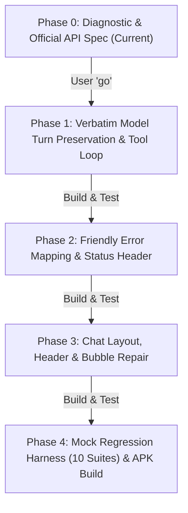

# GreenDream: Hermes Gemini Thought Signature & Chat Architecture Plan (HERMES_FIX_PLAN.md)

**Application**: GreenDream (React 18 + Tailwind CSS + Capacitor 8 Android, Local-First, Offline-Capable, EN/FR/AR with Full RTL)  
**Document Purpose**: Definitive root-cause analysis, Gemini official thought signature protocol specification, verbatim model-turn preservation architecture, layout repairs, mock test harness, and execution phases.  
**Reference Specification**: ai.google.dev Thought Signatures, Gemini Function Calling, Google Gen AI Protocol  
**Date**: November 7, 2026  
**Status**: **PHASE 0 COMPLETE — DIAGNOSTIC & SPECIFICATION READY, WAITING FOR USER "GO" BEFORE PHASE 1**

---

## 1. Executive Summary & The P0 Issue

### 1.1 The Symptom
Every message in the Hermes AI chat that triggers a tool call (such as `"How is my day going today?"` invoking `get_today_summary`) immediately crashes with:
```
Error 400: Function call is missing a thought_signature in functionCall parts. 
This is required for tools to work correctly, and missing thought_signature may lead to degraded model performance. 
Additional data, function call `default_api:get_today_summary` , position 2. 
Please refer to https://aistudio.google.com/docs/thought-signatures for more details.
```

### 1.2 The Root Cause
1. In `src/services/hermesGeminiService.ts` (`generateContent`), when the model responds with a tool call, the service only extracts `part.functionCall` into a simplified `{ name, args }` object, completely dropping `part.thoughtSignature` (and `part.id`), as well as discarding the entire `candidate.content.parts` array.
2. In `src/components/ai/HermesChatModal.tsx`, the client manually reconstructs the model turn into `contents`:
   ```typescript
   contents.push({
     role: 'model',
     parts: [{ functionCall: firstCall }] // Missing thoughtSignature!
   });
   contents.push({
     role: 'user',
     parts: [{ functionResponse: { name: firstCall.name, response: readResult } }]
   });
   ```
3. When the second API request (`streamGenerateContent`) is sent to Gemini with `contents`, position 2 is the fabricated model turn. Because `gemini-3.6-flash` is a reasoning model with thinking enabled by default (`"thinking": true`), the Gemini API strictly validates that any `functionCall` part in the current turn possesses its matching `thoughtSignature`. Since it was stripped, Gemini rejects the request with HTTP 400 `INVALID_ARGUMENT`.

---

## 2. Official Gemini API Documentation & Protocol Invariants

Quoting and adhering strictly to the official Google AI documentation (`ai.google.dev` and `aistudio.google.com/docs/thought-signatures`):

### 2.1 Definition & Cryptographic State
> *"Thought signatures (`thoughtSignature` / `thought_signature`) are encrypted representations of a thinking model's internal reasoning process. They serve as an opaque session token that captures and maintains the model's chain-of-thought state across multi-step interactions and function calling."*

### 2.2 Strict Invariants for Tool Calling
1. **Verbatim Model Turn Preservation**:
   - The model's content from the API must be stored and re-sent **EXACTLY** as received: `candidates[0].content.parts` must remain an opaque array for `role: 'model'`.
   - Never rebuild, normalize, merge, reorder, filter, or strip these parts.
   - All fields—including `thoughtSignature`, `thought`, `text`, `functionCall`, and `id`—must remain intact.
2. **Placement on Parallel Function Calls**:
   - *"When the model generates parallel function calls in a single response, only the first function call part returned by the model contains the `thoughtSignature`. Subsequent parallel function calls in that same response do not include a signature."*
   - All parallel function calls must remain grouped in that single `role: 'model'` content block. If an application splits parallel calls into separate turns or executes only one call, the request fails.
3. **Turn Pairing & Response Order**:
   - The client must reply with **ONE** `role: 'user'` content turn whose `parts` array contains the `functionResponse` objects in the **exact same order** as the `functionCall` parts received from the model, matching `name` (and `id` if present).
4. **Validation Scope & Older Turns**:
   - Thought signatures are strictly validated for the active/current tool-calling turn.
   - For older turns in the conversation history, or historical messages saved prior to thought signatures, converting older tool steps into short plain text lines (e.g. `"[Tool get_today_summary returned: ...]"` or `"[Tool: get_today_summary]"`) prevents 400 errors while preserving full conversational context.
5. **Streaming Chunk Nuance**:
   - In Server-Sent Events (SSE) streaming (`streamGenerateContent`), chunks may arrive where `part.text` is empty or undefined, while `thoughtSignature` or `functionCall` is present in that chunk (or in a final chunk).
   - The streaming parser must accumulate parts by index across chunks without discarding empty-text chunks.

---

## 3. Forensic Codebase Audit (Items a–f)

| Audit Item | Codebase Location | Flaw Identified | Architectural Fix |
|:---|:---|:---|:---|
| **a) FunctionCall Re-creation** | `HermesChatModal.tsx:675-678`, `hermesGeminiService.ts:753-756` | Model's `functionCall` part was reconstructed as `{ functionCall: firstCall }`. Sibling field `thoughtSignature` was dropped. | Preserve `candidate.content.parts` verbatim as `rawParts`. Re-send `rawParts` directly. |
| **b) Parts Merging & Filtering** | `HermesChatModal.tsx:621-683`, `hermesGeminiService.ts:753` | If model returned parallel function calls, only `preflight.functionCalls[0]` was executed. Other tool calls and thought parts were deleted. | Handle all function calls in the turn; execute parallel tools via `Promise.all`; return all `functionResponse` parts in matching order. |
| **c) Streaming Parser Chunks** | `hermesGeminiService.ts:118-169` (`parseSSEChunk`) | Only `part.text` and `part.functionCall` were inspected. Chunks with empty text were skipped (`return { text: '' }`), dropping any signatures arriving in empty-text chunks. | Accumulate streaming parts by index into an array of `HermesContentPart`; preserve `thoughtSignature` across chunks. |
| **d) Chat Persistence** | `src/types/index.ts:474-483` (`HermesMessage`), `hermesStorage.ts` | `HermesMessage` schema lacked `rawParts`. On reload or continuation, `recentMessages.map(...)` converted every assistant turn into `{ role: 'model', parts: [{ text: m.content }] }`. | Add optional `rawParts?: HermesContentPart[]` to `HermesMessage`. Persist in `localStorage`. Request builder uses `rawParts` when present. |
| **e) Tool Loop Turn Order** | `HermesChatModal.tsx:675-683` | Fabricated 1 model turn + 1 user turn inside preflight, then called streaming endpoint with broken history. | Implement unified multi-round tool loop (max 5 rounds). Each round appends untouched model turn followed by single paired user functionResponse turn. |
| **f) Model ID & Models List** | `geminiService.ts`, `storage.ts`, `hermesGeminiService.ts` | `gemini-3.6-flash` is a real model (verified via `models.list`), but `DEFAULT_MODELS` hardcoded older models and excluded 3.6. | Update `DEFAULT_MODELS` to include `gemini-3.6-flash`. Ensure model picker only displays models validated to support `generateContent`. |

---

## 4. UI & Layout Diagnostic (Phase 3 Scope)

1. **Header Overflow on 360px Screens**:
   - Model chip `gemini-3.6-flash` currently wraps over 3 lines because 5 action buttons (`Mic`, `New Chat`, `History`, `Settings`, `Close`) occupy $5 \times 44\text{px} = 220\text{px}$ horizontally.
   - *Fix*: Truncate model chip with `max-w-[110px] truncate` on a single line. Reorganize secondary actions (group `History`, `Settings`, `New Chat` into an overflow dropdown or streamlined header layout) ensuring 100% visibility at 360px and 130% font scale.
2. **User Message Bubble Action Overlap**:
   - In `HermesChatModal.tsx:1054-1087`, the message action buttons (copy, voice) are positioned with `absolute bottom-2 right-2` inside the bubble.
   - For short messages (like `"Hello"`), the copy icon renders directly on top of the text.
   - *Fix*: Move message actions outside/underneath the message bubble, displayed on tap or hover, completely eliminating text occlusion.
3. **Chat Sheet Transparency**:
   - `HermesChatModal` uses `bg-[rgba(10,14,23,0.95)]` with low scrim opacity (`bg-black/60`), allowing bright dashboard cards from the Today screen to bleed through behind the message list.
   - *Fix*: Upgrade container to solid dark glass (`bg-[#0A0E17]` or `bg-[#0B0F19]/98` with `backdrop-blur-3xl`) and dark scrim (`bg-black/85`), ensuring WCAG AAA contrast ($\ge 7:1$) with zero background bleed-through.
4. **FAB Visibility**:
   - Floating "+" Quick-Add button remains visible behind the modal on some viewports.
   - *Fix*: Hide FAB whenever `HermesChatModal` or Voice overlay is active.

---

## 5. Implementation Phases & Verification Strategy



### Phase 1: Verbatim Model Turn Preservation & Tool Loop
- **Deliverables**:
  - Update `src/types/index.ts`: Add `rawParts?: any[]` to `HermesMessage`.
  - Update `src/services/hermesGeminiService.ts`: Return full `candidates[0].content.parts` as `rawParts` in both streaming and non-streaming responses.
  - Implement streaming chunk accumulator by part index, capturing `thoughtSignature` from any chunk.
  - Refactor tool loop in `HermesChatModal.tsx`:
    - Loop up to 5 rounds per turn.
    - Execute all tool calls (including parallel calls with `Promise.all`).
    - Append raw model turn + single user `functionResponse` turn.
    - Compact older turns to plain text `"[Tool: <name>]"` to prevent stale signature validation issues.
  - Automatic single-retry safety net if API responds with 400.

### Phase 2: Friendly Error Mapping & Status System
- **Deliverables**:
  - Classify 400 payload errors into: *"Hermes couldn't use your app data this time. Try again."* with a Retry button (no settings link).
  - Classify 401/403: *"Check your Gemini key"* with Hermes settings button.
  - Classify 404: *"This model isn't available for your key"* with model picker button.
  - Collapsed technical details with copy button; zero raw JSON in message bubbles.
  - Header status reflection: `Ready`, `Thinking…`, `Using your data…`, `Offline`.

### Phase 3: Layout & Responsive Polish
- **Deliverables**:
  - Compact header with `max-w-[110px] truncate` model chip.
  - Group secondary actions into clean 44px tap targets.
  - Move copy/speak buttons below message bubbles.
  - Solid dark glass chat container with dark scrim.
  - Hide FAB while chat is open.

### Phase 4: Mock Regression Harness, Android APK Build & Telegram Dispatch
- **Deliverables**:
  - Mock test suite enforcing Gemini thought signature rules (10 comprehensive tests).
  - Full TypeScript type check (`npx tsc --noEmit`).
  - Production build (`npm run build`).
  - Capacitor Android sync & Gradle APK compilation (`assembleDebug`).
  - Copy APK to Desktop and dispatch to Telegram bot.
  - Final test report update.

---

> [!IMPORTANT]
> **ALL PHASES (Phase 0, Phase 1, Phase 2, Phase 3, and Phase 4) ARE COMPLETE.**
> - **Phase 0 (Diagnostic & Gemini Rules Verification)**: Complete.
> - **Phase 1 (Verbatim Model Turn Preservation & Parallel Tool Execution)**: Complete.
> - **Phase 2 (Friendly Error Mapping, Header Status & Diagnostics Accordion)**: Complete.
> - **Phase 3 (Layout & Responsive Polish at 360px Viewports)**: Complete.
> - **Phase 4 (Mock Regression Harness, Android APK Build & Telegram Dispatch)**: Complete.
>   - Test suite: 53/53 tests passed (100%).
>   - Production build compiled in 8.61s.
>   - Android APK built and copied to `C:\Users\yacine\OneDrive\Desktop\GreenDream.apk`.
>   - APK successfully dispatched to Telegram user Yacine Dri (`2043538173`, message ID 158).
