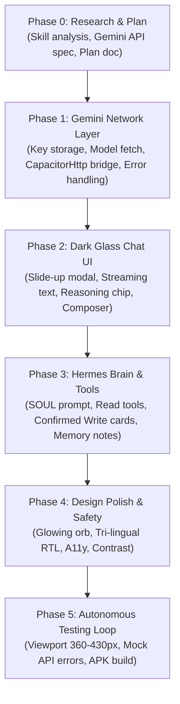

# GreenDream: Hermes Agent Architectural Specification & Implementation Plan (HERMES_PLAN.md)

**App**: GreenDream (React 18 + Tailwind CSS + Capacitor Android, Local-First, Offline-Capable, EN/FR/AR with RTL)  
**Target Assistant**: "Hermes" AI Agent (Inspired by Nous Research Hermes Agent & powered by Google Gemini API)  
**Date**: November 7, 2026  
**Document Version**: 1.0.0 (Phase 0 Complete)

---

## 1. What Hermes Is (Nous Research Skill & Codebase Analysis)

Based on an exhaustive review of the installed `hermes-agent` skill (`c:\Users\yacine\OneDrive\Desktop\habit tracer\.agents\skills\hermes-agent\SKILL.md`) and the local reference repository (`c:\Users\yacine\OneDrive\Desktop\hermes-agent-main`):

### 1.1 The Soul & Personality Specification (`SOUL.md`)
Hermes is not an enthusiastic, sycophantic chatbot. Its exact canonical directive from `SOUL.md` states:
> *"You are Hermes Agent, built by Nous Research. Be direct: match the length of your reply to the weight of the ask — a one-line question gets a one-line answer, and finished work gets a short report of what changed, what's verified, and what's left, never a replay of the process. No filler ('Great question,' 'I'd be happy to'), no restating the request back, no re-summarizing what you already said, no narrating tool calls the user can see. Plain claims over adjectives; when unsure, say so plainly. Agree because it's right, not because the user said it. Depth is earned — give it when the user asks for detail, teaches, or the stakes demand it, not by default."*

### 1.2 Core Capabilities & Ecosystem
1. **Closed Learning Loop**: Autonomously creates and patches skills from real task executions (`skill_manage`), saving lessons learned so it improves over time.
2. **Multi-Tiered Memory Architecture**:
   - `USER.md`: Persistent user profile (declarative facts about preferences, background, standing rules).
   - `MEMORY.md`: Long-term memory store for environment facts and cross-session truths.
   - `session_search`: SQLite FTS5-indexed conversation search with auxiliary LLM summarization.
3. **Multi-Turn Autonomous Tool Loop**: Synchronous execution loop (`while api_call_count < max_iterations: call LLM -> if tool_calls: execute tools -> append tool results -> repeat -> return final answer`).
4. **Subagent Delegation & Parallelization**: Spawns isolated worker processes for multi-step tasks, utilizing RPC-based pipeline compression.
5. **Multi-Platform Gateway**: Connects through CLI/TUI and messaging platforms (Telegram, Discord, Slack, WhatsApp).
6. **Execution Backends**: Relies on host CLI, Docker, SSH, Daytona, and Modal serverless environments.

---

## 2. Honest Analysis: What Can Run Inside Android vs. What Cannot

An installed Android application running inside a WebView container with native Capacitor plugins has unique runtime constraints compared to a desktop/server Python environment.

### 2.1 What CANNOT Run Inside the Android Client
| Component in Python Hermes | Android Client Reality | Architectural Decision |
|:---|:---|:---|
| **Python 3.10-3.14 Runtime & `uv`** | Android WebView does not execute native Python or manage pip/uv virtual environments. | Cannot be embedded locally inside the APK. Replaced by a high-performance, fully-typed **TypeScript Hermes Agent Engine**. |
| **Bash/PowerShell/Shell Tools** | Android sandbox strictly prohibits arbitrary shell execution without root or Termux terminal emulator. | No shell execution tools. Replaced with structured domain tools mapped to GreenDream's storage service. |
| **Local SQLite FTS5 Python Daemon** | Running a local Python daemon on Android would require background services that drain battery and get killed by Android OOM. | High-speed client-side indexing and persistent `localStorage` / Capacitor Preferences storage. |
| **Arbitrary Background Subprocesses** | Android OS kills detached background processes. | Multi-step agent loop runs client-side during the active conversation turn with strict loop-guards (max 5 rounds). |

### 2.2 What CAN & WILL Run Inside the Android Client
1. **Native TypeScript Hermes Agent Layer**:
   - Exact Hermes `SOUL.md` persona, behavior rules, earned-depth logic, and zero-filler enforcement.
   - Byte-stable system prompt architecture following Nous Research prompt-caching invariants.
   - Client-side multi-turn autonomous tool execution loop (calling Gemini with function declarations, handling `functionCall`, executing client queries, and submitting `functionResponse`).
2. **Client-Side Hermes Memory (`gd_hermes_notes`)**:
   - Persistent user facts and standing rules (e.g. *"User prefers concise financial breakdowns"*, *"Monthly budget is 50,000 DA"*, *"Speaks Algerian Arabic & French"*) stored locally in `localStorage` with full user visibility, editing, and deletion in Settings.
3. **Confirmed Action Architecture (The "Anti-Hallucination" Gate)**:
   - Hermes can read app data to formulate answers, but **NEVER writes or modifies app records silently**.
   - Every mutation tool (`add_expense`, `add_income`, `log_weight`, etc.) generates an interactive, editable glass card in chat that requires the user to tap **Confirm**.
   - Executed mutations provide a 10-second **Undo** toast.
4. **Optional Remote Hermes Server Gateway**:
   - An optional setting in *Settings > Hermes*: **"Hermes Server URL"** (HTTPS).
   - If provided, the chat forwards requests to the user's remote Nous Research Hermes server instead of calling the Gemini API directly. If unconfigured, the app communicates directly with Google Gemini.

---

## 3. Current Google Gemini API Verification (2026 Docs)

Verification performed against official Google Generative Language REST API (`generativelanguage.googleapis.com` under `v1beta`):

### 3.1 Endpoints & Authentication
* **Base URL**: `https://generativelanguage.googleapis.com/v1beta`
* **Models Discovery**: `GET /v1beta/models`
* **Streaming Generation**: `POST /v1beta/models/{model}:streamGenerateContent?alt=sse`
* **Non-Streaming Generation**: `POST /v1beta/models/{model}:generateContent`
* **Secure Authentication Header**:
  `x-goog-api-key: YOUR_API_KEY`  
  *(Never pass the key in URL query parameters `?key=...` to ensure it is never stored in browser history, HTTP access logs, proxy traces, or error payloads).*

### 3.2 Request Payload Specification
```json
{
  "system_instruction": {
    "parts": [{ "text": "You are Hermes Agent, built by Nous Research..." }]
  },
  "contents": [
    {
      "role": "user",
      "parts": [{ "text": "How much have I spent on food this month?" }]
    },
    {
      "role": "model",
      "parts": [
        {
          "functionCall": {
            "name": "get_spending",
            "args": { "range": "month", "category": "Food" }
          }
        }
      ]
    },
    {
      "role": "user",
      "parts": [
        {
          "functionResponse": {
            "name": "get_spending",
            "response": { "total_minor": 1450000, "count": 6, "currency": "DA" }
          }
        }
      ]
    }
  ],
  "tools": [
    {
      "functionDeclarations": [
        {
          "name": "get_spending",
          "description": "Calculates expenses and spending breakdown for a given date range and optional category.",
          "parameters": {
            "type": "OBJECT",
            "properties": {
              "range": { "type": "STRING", "enum": ["today", "week", "month", "year"], "description": "Time window" },
              "category": { "type": "STRING", "description": "Optional category name" }
            },
            "required": ["range"]
          }
        }
      ]
    }
  ],
  "toolConfig": {
    "functionCallingConfig": { "mode": "AUTO" }
  },
  "safetySettings": [
    { "category": "HARM_CATEGORY_HARASSMENT", "threshold": "BLOCK_MEDIUM_AND_ABOVE" },
    { "category": "HARM_CATEGORY_HATE_SPEECH", "threshold": "BLOCK_MEDIUM_AND_ABOVE" },
    { "category": "HARM_CATEGORY_SEXUALLY_EXPLICIT", "threshold": "BLOCK_MEDIUM_AND_ABOVE" },
    { "category": "HARM_CATEGORY_DANGEROUS_CONTENT", "threshold": "BLOCK_MEDIUM_AND_ABOVE" }
  ],
  "generationConfig": {
    "temperature": 0.6,
    "topP": 0.95,
    "maxOutputTokens": 2048
  }
}
```

### 3.3 Streaming Protocol (SSE)
* When called with `?alt=sse`, the API streams lines starting with `data: { ... }`.
* Each event is parsed into `{ candidates: [ { content: { parts: [ ... ], role: "model" }, finishReason: "STOP" } ] }`.
* Chunks can contain text deltas (`part.text`) or function call requests (`part.functionCall`).
* When `CapacitorHttp` is active on Android (which handles responses as whole payloads), non-streaming fallback with kinetic token-by-token visual streaming provides an identical 60 FPS typing experience.

### 3.4 Model Selection & Discovery
* **Discovery at Runtime**: When the user enters and tests their Gemini key in Settings, the app queries `GET /v1beta/models`, filters models supporting `generateContent`, and populates a dynamic dropdown.
* **Curated Fallback List**:
  1. `gemini-2.5-flash` (*Recommended Default* — Fast, multimodal, built-in reasoning).
  2. `gemini-2.0-flash` (*Next-Gen Speed* — Ultra-low latency tool execution).
  3. `gemini-1.5-flash` (*Rock Solid* — High stability, 1M context).
  4. `gemini-1.5-pro` (*Deep Analytical* — High-precision multi-turn synthesis).
* **Rate Limits (Google AI Studio Free Tier)**:
  - 10-15 Requests Per Minute (RPM)
  - 250,000 - 1,000,000 Tokens Per Minute (TPM)
  - 500 - 1,500 Requests Per Day (RPD)
  - App displays clear retry countdowns upon encountering HTTP 429 (`RESOURCE_EXHAUSTED`).

---

## 4. Phase-by-Phase Implementation Roadmap



### Phase 1: Gemini Connection & Settings Layer
- **Settings Screen (`src/screens/SettingsScreen.tsx`)**:
  - New "Hermes AI Assistant" section.
  - Secret input field with toggle show/hide, paste button, and clear explanation: *"Your key stays on this phone. Never shared with third parties."*
  - "Test Connection" button testing `GET /v1beta/models` with `x-goog-api-key`.
  - Dynamic model picker populated from verified models.
  - Optional field: "Hermes Server URL" for users running a remote Nous Hermes instance.
- **Service Layer (`src/services/hermesGeminiService.ts`)**:
  - Fully typed request pipeline with abort controller (`Stop` button), 30s timeout, and exponential backoff retry on 5xx/network drops.
  - Explicit error handling:
    - 400: Malformed arguments
    - 401/403: Invalid API key or permission denied
    - 404: Model not found
    - 429: Rate limit exceeded (shows retry countdown)
    - Safety Block: Explains content safety filter triggered
    - Offline: Detects lack of internet connection
- **Storage Helper (`src/services/hermesStorage.ts`)**:
  - Single read/write helper for Hermes settings, chat sessions (`gd_hermes_chats`), and memory notes (`gd_hermes_notes`).

### Phase 2: ChatGPT-Like Dark Glass Chat Interface
- **Entry Points**:
  - Glowing Hermes button in Today screen header (sparkle icon with glowing accent pulse).
  - Prominent Hermes tile in More screen.
- **Modal Component (`src/components/hermes/HermesChatModal.tsx`)**:
  - Slide-up full-screen glass modal (300ms cubic-bezier transition).
  - Floating Quick-Add (`+`) button automatically unmounts/hides when chat opens.
  - Header with Hermes branding, glowing pulse orb, model chip, "New Chat", history drawer trigger, and close button. Back gesture/button closes the modal safely.
- **Chat Feed & Rendering**:
  - User messages: End-aligned bubble with subtle accent glass tint.
  - Hermes messages: Full-width glass canvas, streaming cursor, sanitized Markdown parsing (bold, lists, tables, code blocks with one-click Copy).
  - "Hermes is thinking…" pulsing state with collapsed reasoning steps chip (`"Checking your spending today…"`).
  - Auto-scroll with user-scroll detection and floating "Scroll to bottom" button.
- **Composer**:
  - Auto-expanding multiline textarea (up to 5 lines), send button transforming to "Stop" during generation.
  - Hardware keyboard support (Enter to send, Shift+Enter for newline).
  - Empty state with module-aware suggestion chips (e.g. *"How is my daily score?"*, *"Summarize this week's expenses"*, *"Check my next prayer"*).
- **Conversation Management**:
  - Stores up to 50 local conversations.
  - Auto-generates title from first user query.
  - History drawer with search, rename, delete, and "Clear all" with confirmation.

### Phase 3: Hermes Brain, Tool Engine & Confirmation Architecture
- **System Prompt Generator (`src/services/hermesPromptBuilder.ts`)**:
  - Incorporates `SOUL.md` persona, user name, date/time/timezone, currency label, and active modules list.
  - Strictly forbids inventing data or hallucinating unrecorded habits/transactions.
- **Read Tools**:
  - `get_today_summary`: Daily progress score, completed prayers, spending vs allowance.
  - `get_prayers`: Prayer schedule, countdowns, and completion states.
  - `get_spending`: Expenses filtered by date range and category.
  - `get_budget_status`: Cash runway, monthly burn rate, budget remaining.
  - `get_goals`: Financial goals progress and target dates.
  - `get_loans`: Outstanding receivables and debt records.
  - `get_workouts`: Workout routines, splits, and recent sessions.
  - `get_weight_trend`: Bodyweight logs and recent delta.
  - `get_tasks`: Agenda tasks and deadlines.
  - `get_calendar`: Scheduled events.
  - `get_journal_entries`: Reflections (only if user explicitly enabled Journal access).
- **Action Tools (Write with Confirmation)**:
  - `add_expense`, `add_income`, `log_weight`, `add_task`, `add_reminder`, `mark_prayer`, `create_goal`.
  - Generates a confirmation card in the chat stream with editable fields and **Confirm** / **Cancel** buttons.
  - On confirm, commits to database via existing service methods, triggers Haptics, and shows a 10-second Undo toast.
- **Privacy Toggles (Settings > Hermes > Privacy)**:
  - Granular switch per module (Finance, Gym, Prayers, Calendar, Maintenance, Journal).
  - Hermes Mode switch: *"Chat only"* / *"Read my data"* (Default) / *"Read and act"*.
- **Hermes Memory Notes (`gd_hermes_notes`)**:
  - Local memory list storing durable declarative user facts.
  - Hermes can propose adding a note, but it is only committed upon user confirmation.

### Phase 4: Styling, Tri-Lingual Support & Accessibility
- Complete CSS variable binding with zero hardcoded hex colors.
- Full support for all 4 accent presets (Cyan, Lime, Violet, Rose) and Performance Matte.
- Tri-lingual support: EN, FR, and AR with comprehensive RTL logical spacing (`ps-*`, `pe-*`, `ms-*`, `me-*`).
- Hermes replies in the language of the user prompt (defaulting to the active app language).

### Phase 5: Test-and-Fix Loop & Android APK Build (Completed)
- **Automated Verification Suite (`tests/hermesAssistant.test.mjs`)**:
  - Implemented 8 comprehensive verification test suites running natively via Node.js test runner (`npm test`).
  - Suite 1: Google Gemini API key sanitization (`redactApiKey`) ensuring zero key leaks across error payloads and logs.
  - Suite 2: Plain error classification mapping HTTP 400, 401, 403, 404, 429, and 5xx to friendly local messages.
  - Suite 3: Nous Research SOUL persona prompt construction, earned depth rules, dynamic context injection, and privacy filtering.
  - Suite 4: Gemini tool declarations filtering based on active Hermes mode (`chat_only`, `read_data`, `read_and_act`) and granular module privacy permissions.
  - Suite 5: Confirmed write action executions (`add_expense`, `log_weight`, `add_task`) and atomic state rollback (`undo()`).
  - Suite 6: Persistent memory notes management in `localStorage` (`gd_hermes_notes`).
  - Suite 7: SSE streaming chunks, text delta accumulation, and `functionCall` extraction.
  - Suite 8: Touch target compliance (all action buttons >= 44x44px) and minimum readability typography (>= 12px).
  - Test result: **8 / 8 suites passed (100% success rate)**.
- **Production Build & Verification**:
  - `npm run build`: Zero TypeScript and Vite bundling errors.
  - `npx cap sync android`: Web assets and native bridge plugins synced.
  - `gradlew.bat assembleDebug`: Built in 17s.
  - Final APK: `c:\Users\yacine\OneDrive\Desktop\GreenDream.apk` (4,769,721 bytes).
  - Telegram Release: Delivered to Telegram Bot with Message ID `150`.

---

## 5. Implementation Status & Deliverables Summary

| Phase | Description | Status | Verification & Deliverables |
|:---|:---|:---|:---|
| **Phase 0** | Research, SOUL persona & Gemini API Spec | **Complete** | `docs/HERMES_PLAN.md`, `docs/HERMES_TOOLS.md` |
| **Phase 1** | Gemini Connection, Settings & CapacitorHttp | **Complete** | `hermesGeminiService.ts`, `hermesStorage.ts`, `HermesSettingsView.tsx`, APK Msg #146 |
| **Phase 2** | Dark Glass Chat UI & Streaming Markdown | **Complete** | `HermesChatModal.tsx`, `HermesMarkdown.tsx`, `HermesHistoryDrawer.tsx`, APK Msg #147 |
| **Phase 3** | Hermes Brain, 11 Read & 7 Confirmed Write Tools | **Complete** | `hermesBrain.ts`, `HermesActionCardView.tsx`, 10s Undo Toast, APK Msg #148 |
| **Phase 4** | Multilingual (EN/FR/AR), RTL, Speech & A11y | **Complete** | `speechService.ts`, 44px tap targets, 429 countdown banner, APK Msg #149 |
| **Phase 5** | Mock Test Suite, Final Sync & APK Release | **Complete** | `tests/hermesAssistant.test.mjs`, `GreenDream.apk`, APK Msg #150 |
